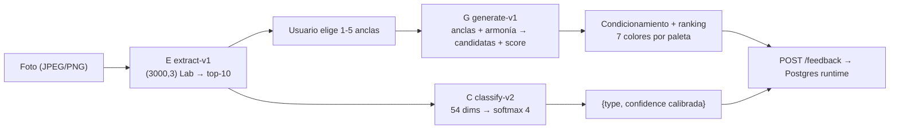
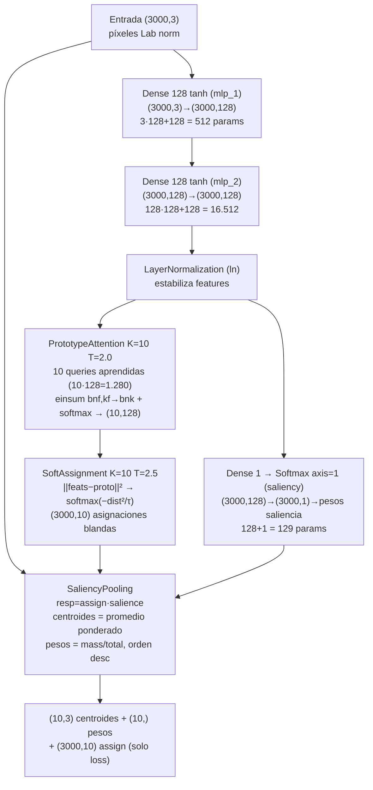
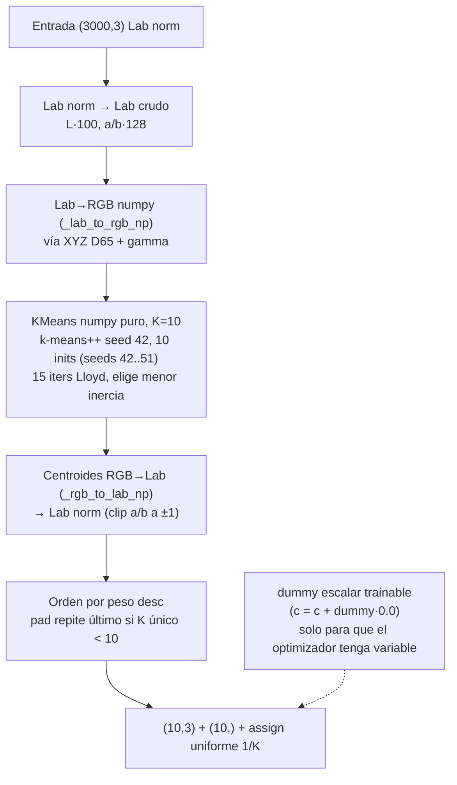
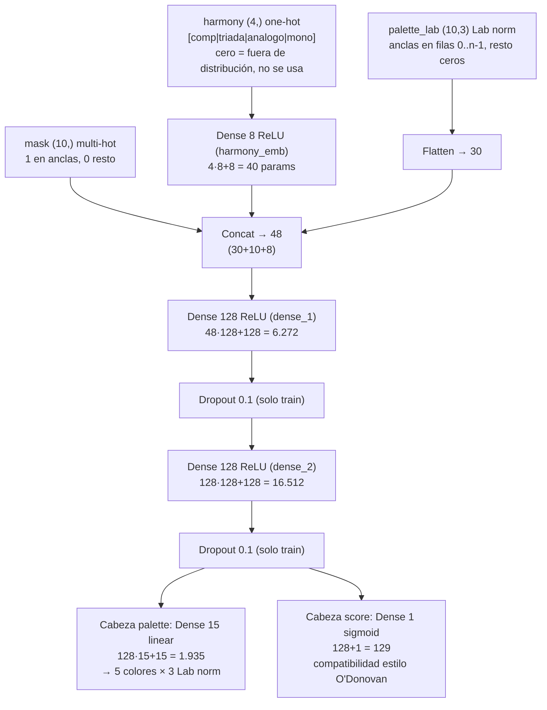
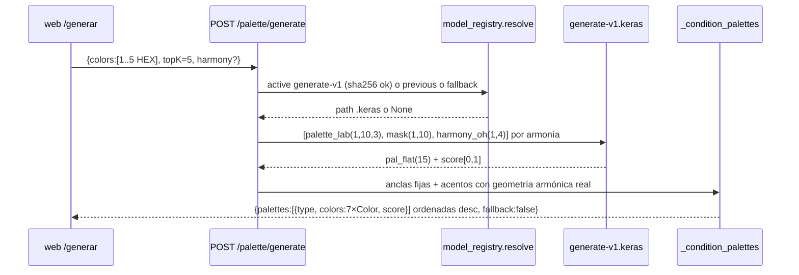
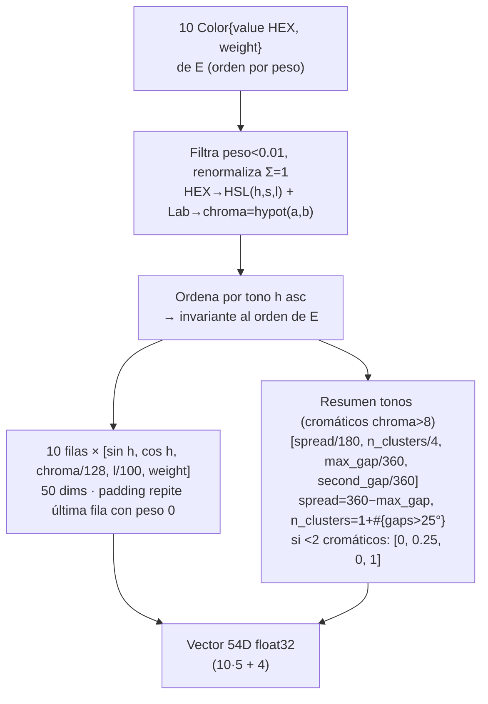
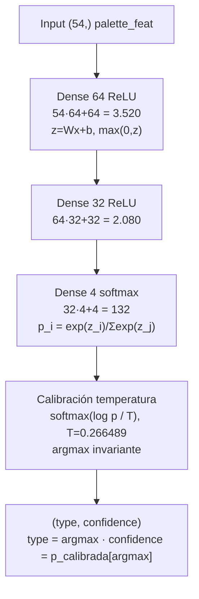
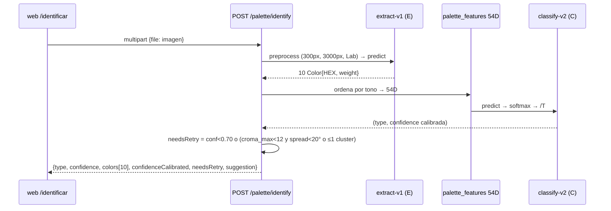
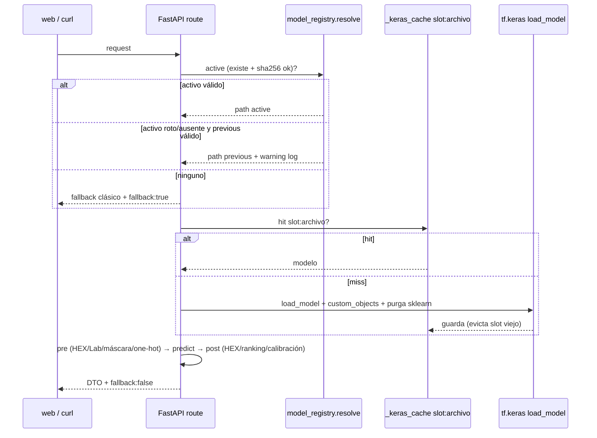
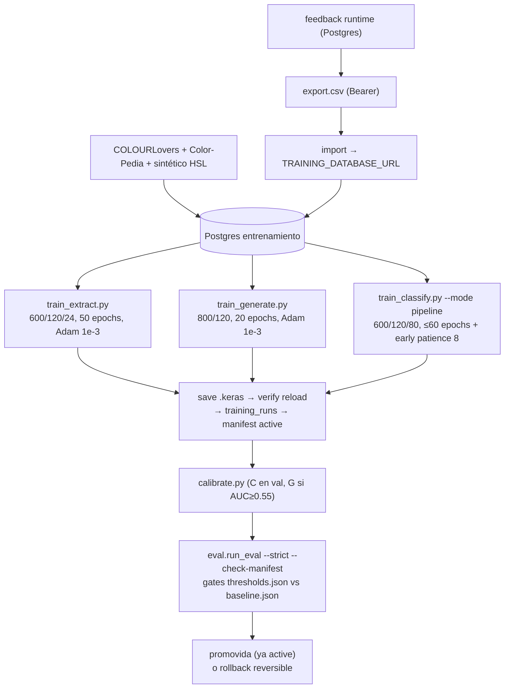

# Redes neuronales E / G / C — arquitectura, inferencia y entrenamiento

> Cierra `xsismadn3ss/Combina2#32`. Complementa [`models.md`](./models.md) (referencia
> técnica por slot), [`architecture.md`](./architecture.md) (visión de software),
> [`data.md`](./data.md) (datos), [`api.md`](./api.md) (contratos) y
> [`retraining.md`](./retraining.md) (operativa). Este documento explica **cómo
> funcionan las neuronas en cada capa, cómo fluyen los datos hasta la respuesta,
> qué entra y qué sale, y cómo se entrenó y guardó cada modelo**.

Stack real: Python 3.12 + TensorFlow 2.21.0 / Keras 3.15.1 (solo `.venv-tf` y Docker;
el runtime sin TF responde por fallback clásico). Todo el color vive en **CIELAB
normalizado** (`backend/app/ml/color_spaces.py`): `L∈[0,1]`, `a/b∈[-1,1]`
(`lab_normalize` = `L/100`, `a/128`, `b/128`; inversa `lab_denormalize`).

## Cómo leer esto si nunca viste machine learning

Piensa en una **neurona** como un controlito de mezcla: recibe varios números, les pone
un "volumen" distinto a cada uno (pesos), los suma, y decide cuánto deja pasar
(función de activación como `tanh` o `ReLU`). Una **capa** es un equipo de esos
controlitos trabajando a la vez; una **red** es varios equipos en fila: cada equipo
reescribe los datos en un lenguaje un poco más útil para la tarea final.

Analogía de todo el sistema:

- **E (extractora)** = mirar una foto con miles de puntitos y resumirla en una caja de
  **10 crayones** + cuánto se usa cada uno. Entrada: puntitos. Salida: crayones.
- **G (generadora)** = te dan 1–5 crayones que te gustan y te completa la caja hasta 7
  con colores que combinan, además de una **nota de 0 a 1** (score) de qué tan bien quedó.
- **C (clasificadora)** = mira la caja de 10 crayones y le pone **una etiqueta**:
  `complementario | triada | analogo | monocromatica`, con un % de confianza.

Los números raros como `(3000,3)` se leen así: 3000 puntitos × 3 números por puntito
(claridad L, verde↔rojo a, azul↔amarillo b). Cuando veas un diagrama Mermaid con
`(3000,128)`, significa: los mismos 3000 puntitos, pero ahora cada uno descrito con 128
números internos que la red inventó para trabajar mejor. Los diagramas técnicos que siguen
dicen exactamente lo mismo que esta analogía, solo que con las medidas precisas.

## 0. Mapa general

| Red | Slot / archivo activo | Rol | Entrada | Salida | Params | Calibración |
|---|---|---|---|---|---|---|
| E extractora | `extract-v1.keras` (híbrida `HardKMeans`) | foto → top-10 colores + pesos | `(3000,3)` píxeles Lab norm | `(10,3)` centroides + `(10,)` pesos (+`(3000,10)` assign solo train) | **1** (dummy escalar; el KMeans es numpy puro) | `method:"none"` |
| G generadora | `generate-v1.keras` | anclas → paletas rankeadas | `(10,3)` Lab + `(10,)` máscara + `(4,)` one-hot armonía | `15 (=5×3)` Lab + `score∈[0,1]` por propuesta | **24.888** | Platt **rechazado** (AUC 0.3516 < 0.55) |
| C clasificadora | `classify-v2.keras` (rollback `classify-v1.keras`) | paleta E → armonía | v2: `54` dims conjunto · v1: `40` dims legacy | `softmax 4` (`complementario\|triada\|analogo\|monocromatica`) | v2 **5.732** · v1 **4.836** | v2 temperatura **T=0.266489** en val; v1 sin calibrar |

Los tres endpoints usan el mismo patrón: resolver versión → cargar `.keras` perezoso →
pre/post-proceso numpy → fallback clásico si no hay red (`fallback: true`, nunca 503
por modelo ausente salvo que el fallback tampoco pueda responder).

## 1. Representación común del color

- `ColorConverter.hex_to_lab / lab_to_hex / hex_to_hsl / hsl_to_hex` + `lab_normalize /
  lab_denormalize` en `backend/app/ml/color_spaces.py`.
- Preproceso de imagen (`backend/app/ml/datasets.py:preprocess_image`): lado mayor 300px,
  RGBA→RGB sobre blanco, `sample_pixels` 3000 px determinista (seed 42), RGB→Lab,
  normalización. **El mismo preproceso se usa en entrenamiento (maestro), inferencia
  (`inference._extract_with_model`) y eval** — por eso la paridad ΔE es comparable.
- Pesos de E: se recortan a `≥0`, se renormalizan a suma 1, se filtran `<0.01` y se
  reordenan por peso descendente (`inference.extract_colors_from_outputs`).

## 2. Red E — extractora

Código: `backend/app/ml/extract_model.py` (`build_extract_model`,
`build_kmeans_model`, capas `PrototypeAttention`, `SoftAssignment`,
`SaliencyPooling`, `HardKMeans`). Loss: `backend/app/ml/losses.py`.
Entrenamiento: `backend/scripts/train_extract.py`.

### 2.1 Camino amortizado (entrenable, NO desplegado)

Existe para destilar al KMeans clásico. Con ~600 mosaicos no alcanza ΔE<5 estable
(converge ~8-12); se documenta porque es el diseño neuronal puro.

> **En palabras simples:** cada píxel pasa por dos equipos de 128 controlitos que lo
> re-describen ("¿este puntito tira más a cálido? ¿a oscuro?"). Luego 10 "capataces"
> (prototipos) compiten por quedarse con píxeles parecidos — como 10 imanes que atraen
> los tonos que más se les parecen — y una votación (saliencia) decide qué píxeles pesan
> más (un cielo enorme pesa más que un puntito rojo). Al final se promedian los grupos y
> salen los 10 crayones ordenados del que más aparece al que menos.

- `SaliencyPooling.call`: `resp = assign·salience`, `mass = Σresp + 1e-8`,
  `weights = mass/total`, `centroids = einsum(resp,pixels)/mass`, `argsort DESC`.
- Total aproximado del camino amortizado: ~18.700 params entrenables.

### 2.2 Camino desplegado `extract-v1.keras` — `HardKMeans` (1 param)

> **En palabras simples:** en producción no usamos la versión "inteligente" de arriba
> sino una que **cuenta de verdad**: agrupa los puntitos en 10 montones de colores
> parecidos (KMeans), como separar lentejas por color en 10 platos, y se queda con el
> color promedio de cada plato. Es 100% repetible (misma foto → mismos 10 crayones) y
> por eso sí cumple la meta de parecerse al método clásico (ΔE<5). El "1 parámetro" es un
> truco técnico para que el programa no se queje de que "no hay nada que entrenar".

- La capa envuelve `_batch_kmeans_lab_to_rgb` con `tf.numpy_function` (fija shapes
  `(None,10,3)/(None,10)/(None,None,10)`) y se recarga sin sklearn vía
  `EXTRACT_CUSTOM_OBJECTS`. El path con red E **purga `sklearn` de `sys.modules`**
  (`inference.load_keras_model`).
- Maestro de destilación: `ClassicPaletteIdentifier` (`backend/app/services/classic.py`:
  `MAX_CLUSTERS=10`, `MAX_SIZE=300`, `RANDOM_STATE=42`, `N_INIT=10`, thumbnail completo).
- Eval de paridad: 10 mosaicos fijos (size 64, JPEG 80, seeds 5000..5009) por el camino
  real `inference.extract_image_colors` vs clásico → **ΔE76 medio 3.8119 (<5), máx
  14.1106 (<20), fallback 0/10**.

### 2.3 Loss y datos de E

- Entrenamiento: `make_extract_sinkhorn_loss(entropy λ=1e-3, assignment rampa 0→1,
  ε Sinkhorn 100→10 recocido lineal)`. Fórmula: MSE-Lab **desnormalizado** con
  emparejamiento blando Sinkhorn doblemente estocástico (`1/K`, 25 iters, dominio log)
  + MSE pesos blandos + `λ·H(w)` + `λ_assign·H̄(assign)`. Evita cambios bruscos de
  asignación del greedy duro (`losses.reorder_matched` solo se usa en debug/eval).
- Datos (`benchmarks.synthesize_extract_dataset` + `datasets.synthesize_mosaic`):
  paletas de la DB de entrenamiento (Postgres `TRAINING_DATABASE_URL`); si no alcanzan,
  relleno aleatorio offline determinista. Por paleta: mosaico de franjas con áreas
  Dirichlet + ruido luz `gain∈[0.95,1.05]` + gaussiano σ=3 + JPEG `quality 60-95`.
  Defaults: `--n-train 600 --n-val 120 --n-test 24 --epochs 50 --batch 32 --lr 1e-3
  --temp 2.5 --entropy 1e-3 --seed 42 --size 128`.
- Trucos de entrenamiento: init MLP con identidad escalada 0.7 + `proto_attention.queries`
  desde KMeans en features (`init_prototypes_from_data`); reanimación de clusters muertos
  (`mass<0.005`) cada 4 épocas (`restart_dead_units`, `--restart-every 4`).
- Guardado: solo si paridad ΔE<5 (o `--force`); `save_and_register` verifica recarga con
  `EXTRACT_CUSTOM_OBJECTS` y 3 salidas, inserta `training_runs` (run 14 para v1) y llama a
  `model_registry.register_version` (sha256, `createdAt`, `gitSha`, `tfVersion`,
  `kerasVersion`, métricas).

## 3. Red G — generadora

Código: `backend/app/ml/generate_model.py` (`build_generate_model`,
`generate_palette_loss`, `palette_loss_with_ciede`). Inferencia:
`backend/app/services/inference.py` (`_generate_with_model`, `_generate_candidates`,
`_condition_palettes`, `generate_palettes`). Entrenamiento:
`backend/scripts/train_generate.py`.

### 3.1 Arquitectura neurona por neurona

> **En palabras simples:** G aplasta todo lo que sabe (tus anclas + cuáles elegiste +
> el estilo pedido) en una lista de 48 números, la pasa por dos equipos de 128
> controlitos que aprenden "qué combina con qué", y al final dos cabezas deciden: una
> dibuja 5 colores nuevos y la otra pone la nota (score). `ReLU` solo significa "lo
> negativo se vuelve cero" (como un grifo que no deja pasar para atrás) y `Dropout`
> significa "en entrenamiento apago controlitos al azar para que nadie se vuelva
> imprescindible" — en producción ya no se apaga nada.

Total: 40+6272+16512+1935+129 = **24.888 params** (344 KB). Loss de entrenamiento:
`MSE + 0.1·distancia euclidiana Lab diferenciable` (aprox. **CIE76**, el nombre histórico
`CIEDE2000 aprox` era incorrecto) en cabeza `palette` + `BCE` en `score`
(`loss_weights palette 1.0 / score 0.5`). Eval B1 usa **CIEDE2000 real** (Sharma et al.,
`app/ml/metrics.py`) + CIE76 como referencia: línea base v1 (40 paletas seed 99)
CIEDE2000 **13.0981** (≤14.5 ✓), CIE76 23.5952, MSE **0.025599** (≤0.05 ✓),
score medio 0.9423 (std 0.0319), AUC score→buena reconstrucción **0.3516**.

### 3.2 Flujo de inferencia (qué entra, qué sale)

Detalles que el diagrama resume:

1. **Prepro** (`_generate_with_model`): HEX→Lab crudo→Lab norm, `mask=1` en anclas
   (máx 10), one-hot de la armonía pedida. Modelo multi-input (lista o dict).
2. **Una inferencia por armonía**: con `harmony` explícita hay 1 llamada; con
   `harmony=null` se infiere una vez por cada armonía de la rotación determinista
   (`harmony_sequence`: round-robin `[complementario,triada,analogo,monocromatica]`
   con inicio `sha256(anclas) mod 4`; `topK≥4` cubre las 4 clases). No se envía one-hot
   todo-ceros porque estaría fuera de distribución.
3. **Post**: clip Lab a `[0,1]/[-1,1]`, copia exacta de las bases en los primeros slots,
   Lab→HEX, ruido gaussiano determinista por contenido (`seed=sha256(anclas)`, σ=0.015·k)
   para `k>0` + decaimiento `score·(1-0.04·k)`, Platt **no-op** (G rechazada), ranking desc.
4. **Condicionamiento** (`_condition_palettes`, `PALETTE_SIZE=7`): las anclas se conservan
   al inicio (`primary`+`secondary`); los acentos se generan proyectando el tono (HSL) del
   head G sobre la geometría real (`offsets`: analogo ±30°, triada 120°/240°, complem.
   180°, mono 0°) con rotación `index·37°`, mezclando `s/l` del head (70% ancla + 30%
   propuesta) y `_fill_palette_colors` (ΔL=18° por ronda). Cada `type` refleja la geometría
   usada. Con 1–4 anclas se añaden 6–3 acentos; con 5 anclas, 2.
5. **Respuesta**: `GenerateResponse{palettes: ScoredPalette{type, colors[7], score},
   fallback}`. Fallback clásico HSL (`ClassicPaletteGenerator`) si no hay red.

### 3.3 Entrenamiento y guardado de G

- Datos: `benchmarks.build_generate_palette_list` — paletas de la DB de entrenamiento
  (COLOURLovers top-1000×8 hue, Color-Pedia ~50k, sintético HSL); fallback sintético
  `ClassicPaletteGenerator` + ruido Lab si no alcanzan. Por paleta GT (5 colores):
  muestra con 1–3 bases visibles (`palette_to_generate_dataset`).
- Defaults: `--epochs 20 --n-train 800 --n-val 120 --batch 32 --lr 1e-3 --mu 0.1
  --seed 42`, Adam, `EarlyStopping` no (fit directo), registra si `val_ciede2000<30`
  (umbral de guardado, distinto del gate de eval ≤14.5).
- Calibración B2 (`scripts/calibrate.py --slot generate`): usa feedback real si hay ≥50
  filas, si no proxy de reconstrucción (40 paletas seed 99). Exige AUC≥0.55
  (`thresholds.calibration.require_auc_min`); v1 da 0.3516 → `register {method:"platt",
  calibrated:false, reason:"score_auc_below_threshold"}`. `inference._apply_active_platt`
  solo aplica si `calibrated:true` (hoy no-op). No se invierte el score.
- Guardado idéntico a E: recarga con `GENERATE_CUSTOM_OBJECTS` (2 salidas), fila
  `training_runs` (run 15), `register_version` con métricas CIEDE2000/CIE76/MSE/score/AUC.

## 4. Red C — clasificadora

Código: `backend/app/ml/classify_model.py` (`build_classify_model`,
`cce_label_smoothing`), `backend/app/ml/color_features.py` (`palette_features` 54D,
`palette_features_legacy` 40D, `palette_is_low_information`). Inferencia:
`inference._classify_with_model`, `inference.identify_image`. Entrenamiento:
`backend/scripts/train_classify.py` (modos `pipeline`=v2 / `synthetic`=v1 legacy).

### 4.1 Entrada 54D (v2 activa, pipeline-consistente)

> **En palabras simples:** antes de clasificar, convertimos la caja de crayones en una
> ficha de 54 números que no depende del orden en que llegaron: ordenamos por tono
> (como ordenar un arcoíris), describimos cada crayón con 5 números (para dónde apunta
> su tono con seno/coseno — así el rojo del inicio y el del final del círculo no se
> pelean — + qué tan vivo es + qué tan claro + cuánto pesa) y añadimos 4 números resumen
> ("¿los tonos están juntos o repartidos? ¿hay 1 grupo o 4?"). Esa ficha es lo que la red
> realmente mira. La versión vieja (40D) en cambio dependía del orden, como una receta que
> sale mal si cambias el orden de los ingredientes.

Ejemplo: un rojo `h=0°` aporta `[sin=0, cos=1, chroma/128, l/100, w]`; el seno/coseno evita
la discontinuidad 0°/360°. La entrada legacy v1 es distinta: `10·Lab norm + 10 pesos`
(40D, orden por peso, **dependiente del orden**).

### 4.2 Arquitectura y cálculo neurona por neurona

> **En palabras simples:** la ficha de 54 números entra a un equipo de 64 controlitos
> que detectan pistas ("hay dos tonos opuestos", "todo es grisáceo"), luego a otro de 32
> que combina esas pistas ("opuestos + vivos = complementario"), y al final 4 salidas
> compiten con `softmax`: es como repartir 100% de probabilidad entre las 4 etiquetas.
> La que más % saca gana. La "temperatura" T=0.266 solo ajusta qué tan segura se muestra
> la red (baja T = más tajante), pero **no cambia al ganador**.

- v2: 3520+2080+132 = **5.732 params**. v1 (40D): 40·64+64=2624 +2080+132 = **4.836**.
- Loss: `CategoricalCrossentropy(label_smoothing=0.05)`, Adam lr 1e-3, batch 32,
  `EarlyStopping(monitor=val_accuracy, patience=8, restore_best_weights)`.
- Detección de dimensión (`_classify_input_dim`): lee `model.input_shape`/`inputs[0]`; 54→
  features nuevas, cualquier otro/None→legacy (rollback seguro).
- Métricas v2 en pipeline E→C (test 80 paletas, seed 20042, splits disjuntos
  estratificados por `harmony_label`): accuracy **0.975** (≥0.90 ✓), macro-F1 **0.9757**
  (≥0.90 ✓), recall por clase {comp 0.947, triada 0.957, analogo 1.0, mono 1.0} (≥0.85 ✓),
  confusión `[[18,0,0,1],[1,22,0,0],[0,0,16,0],[0,0,0,22]]`, NLL 0.1324, ECE 0.0916.
  v1 en el mismo test: accuracy 0.375, F1 0.3519 (solo sirve como rollback).
- Calibración (`scripts/calibrate.py --slot classify`, búsqueda determinista en log-T
  rango 0.2–5.0): ajustada **solo en val** (120 paletas seed 10042): ECE 0.1074→0.0210,
  NLL 0.1377→0.0429, T=0.266489 (`fittedOn:"pipeline-val"`). En test (referencia):
  ECE 0.0916→0.0275 (≤0.10 ✓), NLL 0.1324→0.0929 (≤cruda ✓), accuracy invariante.
  Manifiesto: `{method:"temperature", calibrated:true, temperature, fittedOn, n, eceBefore/
  After, nllBefore/After, range}`. `identify_image` expone `confidenceCalibrated=true` y
  `confidence` ya calibrada.

### 4.3 Pipeline E→C y guard de reintento

- `IDENTIFY_MIN_CONFIDENCE=0.70` (risk-coverage en test: 100% cobertura, 97.5% accuracy).
- Baja información (`palette_is_low_information`): croma máx `hypot(a,b)` <12 **y**
  (`spread<20°` o `≤1` cluster de tono). Un dúo apagado con hues distintos
  (`#E6DCD2`/`#D2E1EB`) no dispara. Sugerencias en español (`_GRAY_SUGGESTION` /
  `_RETRY_SUGGESTION`). Con `fallback:true` (sin C) se responde `type:"predominant"`,
  `confidence:1.0`, `needsRetry:false`.

## 5. Backend: cómo usa los modelos para responder

- `backend/app/services/model_registry.py` (puro Python, sin TF): única fuente de verdad
  `backend/models/manifest.json` (schemaVersion 2). Por slot: `active`, `previous`,
  `versions` (nunca se borran), `files{sha256, createdAt, gitSha, trainingRunId,
  tfVersion, kerasVersion, metrics, calibration, params?, note?}`. Legacy sin
  `files`/`sha256` se tolera como `unhashed`. Nunca editar a mano (`scripts/manage_models.py`).
- `backend/app/services/inference.py`: `active_keras_path → resolve`,
  `load_keras_model` (lazy, cache `slot:archivo`, purga sklearn dos veces),
  `readiness_report` (`GET /ready`: 200 solo si E+G+C cargan; `storage:"models_only"` +
  `database:{configured,reachable}` informativo que no altera el código),
  `GET /models` read-only sin TF (nombres, nunca rutas absolutas).
- `GET /health` es liveness puro (no carga modelos ni DB). `/palette/*` y `/ready` siguen
  funcionando si Postgres cae; solo `/feedback` y export devuelven 503/`Retry-After: 30`.
- Caché caliente: tras `activate`/`rollback` reiniciar el proceso o llamar a
  `inference.clear_model_cache()`. Caché de eval `.eval-cache/` (gitignored) con clave
  `(versión E + 8 hex sha256 + hash contenido split)` — reentrenar invalida solo.

## 6. Datos: qué se obtuvo y de dónde

Orden de prioridad (`docs/data.md` §8, `benchmarks.build_*_palette_list`):

1. **`boltuix/color-pedia` (HF, ~50k, Parquet, MIT)**: RGB/HEX + nombre + emoción.
   Arranque sin scraping; pre-entrena G y head de compatibilidad.
2. **COLOURLovers API `GET /api/palettes/top`**: top-1000 × 8 `hueOption`
   (red/orange/yellow/green/aqua/blue/violet/fuchsia) ≈7k paletas de 5 colores con ranking.
   Para G + C.
3. **Sintético motor HSL actual**: `(base, armonía)→paleta + ruido Lab`, etiqueta perfecta
   día-0 para C y bootstrap de G; plan B completo si (1)+(2) no rinden.
4. **WikiArt: descartado (Fase 6, ADR)** — E destila KMeans sobre mosaicos sintéticos +
   paletas de la DB; el híbrido ya cumple ΔE<5.
5. **Mosaicos E / feedback**: `synthesize_mosaic` + `feedback` runtime (Postgres
   `DATABASE_URL`, snapshot JSONB sin FK, fingerprint idempotente) → export CSV con Bearer
   → `import_feedback_csv --apply` a `TRAINING_DATABASE_URL` (solo local). `training.db`
   SQLite queda como evidencia histórica deprecada (lector one-shot
   `migrate_sqlite_to_postgres.py`).

Esquema único Alembic en ambas DBs (`images`, `extracted_colors`, `palettes(key UNIQUE)`,
`palette_colors`, `training_runs`, `feedback`). Splits 80/10/10 estratificados por
`harmony_label`/`source` con semillas fijas (train 42, val 10042, test 20042) y buckets
disjuntos — ningún `test_seed` pisa train/val; relleno sintético con semilla por split.

## 7. Entrenamiento reproducible por red

> **En palabras simples:** entrenar es como enseñar a cocinar por repetición: la red
> prueba, alguien le dice qué tan lejos quedó del plato perfecto (la *loss*: un número
> que es 0 cuando clava el color y grande cuando falla), y ajusta un poquito sus
> volúmenes (pesos). Repetir miles de veces con fotos distintas es una *época* tras otra.
> Guardar el `.keras` es congelar la receta ganadora; el `manifest.json` es el libro donde
> se anota qué receta está activa, con su huella digital (sha256) para detectar si alguien
> la tocó, y la anterior guardada por si hay que volver atrás (rollback).

Requisito: `.venv-tf` (Python 3.12, `requirements-ml.txt`: TF 2.21.0/Keras 3.15.1),
Postgres local (`docker compose up -d postgres` + `db_bootstrap --target all --create
--upgrade`), rama limpia. Todos los scripts eligen la siguiente `vN` libre, fallan si el
destino existe (salvo `--force` desechable), verifican recarga del `.tmp-*.keras`,
insertan `training_runs(git_sha, params, metrics, tf/keras)` y registran con
`register_version` (nueva → `active`, anterior → `previous`).

| | E (`train_extract.py`) | G (`train_generate.py`) | C (`train_classify.py --mode pipeline`) |
|---|---|---|---|
| Comando base | `.venv-tf/... train_extract.py --epochs 50 [--use-kmeans]` | `train_generate.py --epochs 20 --n-train 800` | `train_classify.py [--mode pipeline\|synthetic]` (def. pipeline 60/600/120/80) |
| Datos | mosaicos por paleta DB + Dirichlet/JPEG (ver §2.3) | GT 5 colores → muestra 1–3 bases visibles | mosaicos 96–160px, JPEG 60–95, pesos Dirichlet mín 0.08, orden barajado → features E real (caché `.eval-cache/`) |
| Opt/loss | Adam 1e-3, Sinkhorn §2.3, batch 32 | Adam 1e-3, MSE+0.1·CIE76 + BCE (pesos 1.0/0.5), batch 32 | Adam 1e-3, CCE smoothing 0.05, batch 32, early patience 8 |
| Gate guardado | paridad ΔE<5 | `val_ciede2000<30` | `val_accuracy≥0.70` |
| Run actual | 14 (extract-v1) | 15 (generate-v1) | 17 (classify-v2; 16 = v1 legacy synthetic) |

Post-entreno: `calibrate.py --slot all` (C temperatura en val, G Platt si AUC≥0.55),
`eval.run_eval --strict --check-manifest [--json/--md]` (12/12 gates PASS, 26 métricas,
tolerancia drift 10%; fuentes `eval/thresholds.json`, `eval/baseline.json`), y
`manage_models.py list/verify/rollback/activate` según `retraining.md`.

## 8. Dónde seguir

- Referencia exacta de pesos/contratos: `docs/models.md`, `docs/api.md`.
- Operativa (feedback→dataset→train→calibrate→eval→promote/rollback): `docs/retraining.md`.
- Registro vivo: `backend/models/manifest.json` + `GET /api/v1/models`.
- Código: `app/ml/{extract_model,generate_model,classify_model,color_features,
  color_spaces,losses,metrics,datasets,benchmarks}.py`, `app/services/{inference,
  model_registry,classic}.py`, `scripts/train_*.py`, `scripts/calibrate.py`,
  `eval/run_eval.py`.
